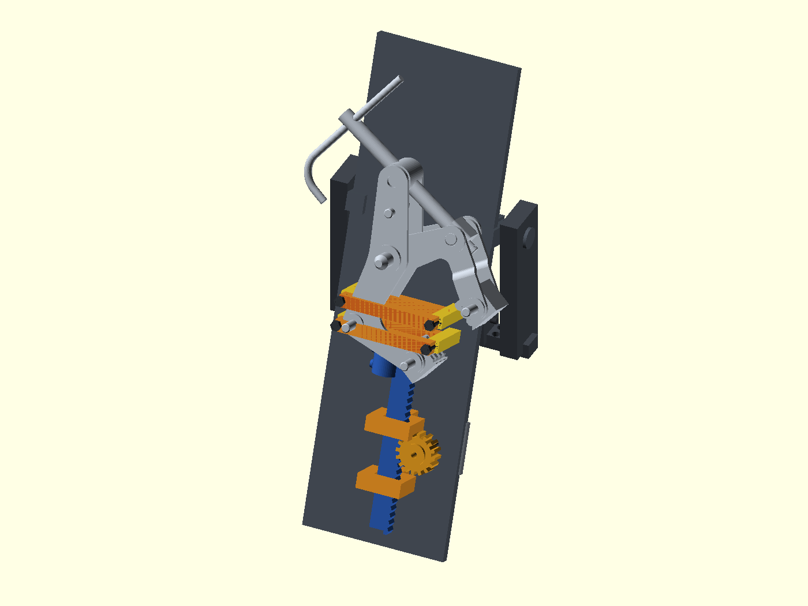
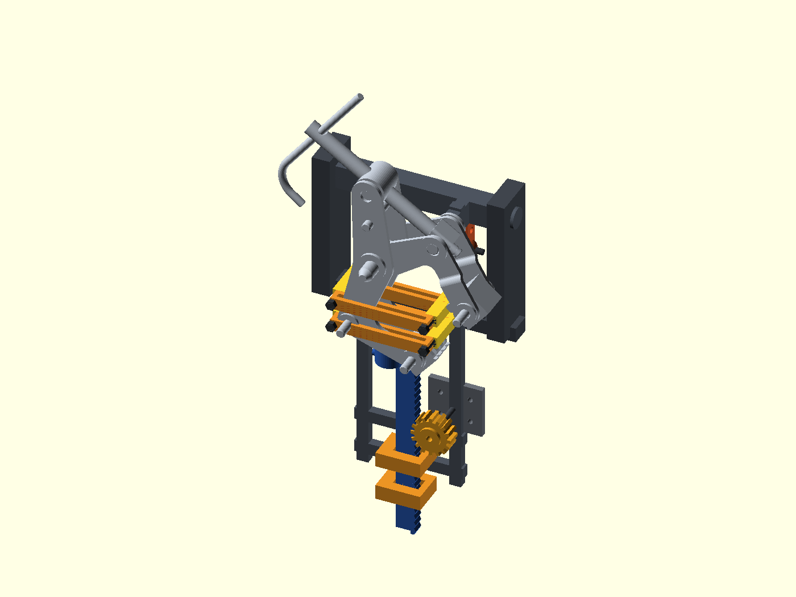
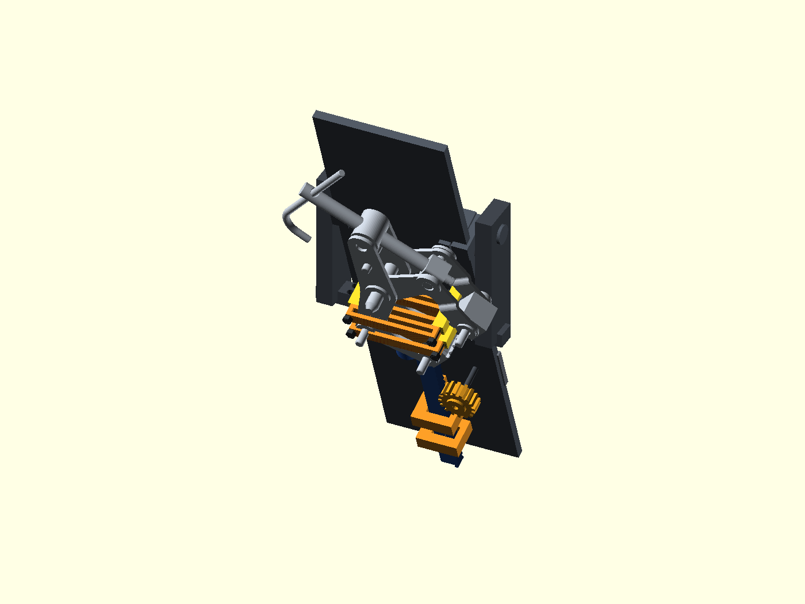

# Standalone clamp drive and pitch cradle study

This is a separate mechanism study for the clamp reference mesh `Michelangelo Dealberti FInal Clamp Design.stl`. It is not the active pivot-jaw model in the workspace root `gripper_study.scad`.

## Mechanism layout

- Four split clips attach the cradle to two long guide-plate components in the STL at Z=12 and 28 mm. Their measured X span and 2.6 mm plate thickness are geometry inputs; the mesh does not say whether these components are fixed chassis rails.
- A candidate Ø18 mm sleeve and two M3 set screws connect the presumed center member to a translating rack through a solid side web. The mesh does not establish that member's axis, diameter, straight engagement length, or motion.
- The rack translates on Z and meshes with a Y-axis pinion. The pinion drives a generic 4 mm shaft with a transverse-pin proxy and a rear servo plate. No servo body, output spline, rated hub, or actual coupling is selected.
- The rack guide layout is a collision-checked candidate: 128 mm rack; pinion center 54 mm from the sleeve datum; guide centers 76 and 100 mm from that datum; ±20 mm rack travel. A side support rib is moved clear of the rack path.
- The clamp and drive are carried on an X-axis pitch cradle. A telescoping pin-to-pin linkage shows a possible actuator connection; the pitch actuator and required angle/stroke are not selected.

## Files and checks

- `rack_and_pinion_pitch_layout.scad` — parametric layout and two intersection diagnostic views.
- `validate_rack_pitch_study.ps1` (workspace root) — compiles this source with hard warnings and checks rack/guide and pinion/guide intersections at -20, 0, and +20 mm travel.
- `reference_mesh_analysis.md`, `reference_mesh_components.md`, `reference_mesh_axis_sections.md`, and `reference_mesh_projection.svg` — mesh measurements and component visualization.
- `FIT_MEASUREMENTS.md` — inputs still needed for exact interface fit.

The reproducible check found empty guide/rack and guide/pinion intersections for its six tested cases. It does **not** test rack/pinion tooth mesh, moving clamp collisions, pitch-link range, structural strength, actuator coupling, vehicle fit, or underwater performance.

## Pitch position previews

Generated from the parametric assembly on GitHub with the reference STL visible:

| Down (-20°) | Neutral (0°) | Up (+20°) |
|---|---|---|
|  |  |  |

## Fit status

The separate `FIT_MEASUREMENTS.md` records current assumptions and evidence. Confirm the two guide plates are fixed and obtain editable clamp CAD or direct measurements for the moving member before building. Keep this as a layout candidate; it is not a fabrication or powered-use release.

